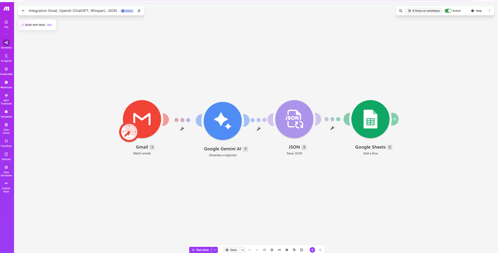
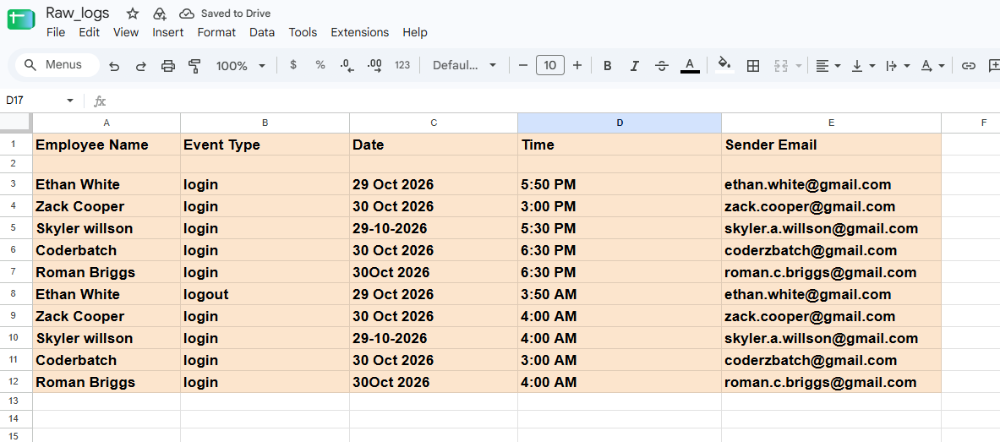

# Automated Employee Attendance Tracker (Make.com + Gemini AI)

An end-to-end, event-driven automation workflow built in **Make.com** that monitors incoming attendance emails via **Gmail**, uses **Google Gemini AI** to extract and structure unstructured text into JSON, and logs verified attendance records directly into **Google Sheets**.

---

## Business Problem & Solution
* **The Bottleneck:** Manually reading daily login/logout emails and copying timestamps into spreadsheets is slow, repetitive, and prone to human data-entry errors.
* **The Solution:** A zero-touch automation pipeline that watches incoming emails, leverages LLM parsing to handle varying email formats, validates the schema via JSON parsing, and appends clean, standardized rows to Google Sheets automatically.

---

## System Architecture

1. **Trigger — Gmail (`Watch emails`):** Monitors the inbox on a schedule for incoming employee attendance notifications.
2. **AI Extraction — Google Gemini AI (`Generate a response`):** Reads the raw email body and extracts key attributes in a strict JSON format.
3. **Data Structuring — JSON (`Parse JSON`):** Converts the raw AI output string into mapped data variables for downstream routing.
4. **Destination — Google Sheets (`Add a Row`):** Appends the structured record into the `Raw_logs` tracking sheet:
   * **Column A:** `Employee Name`
   * **Column B:** `Event Type` (`login` / `logout`)
   * **Column C:** `Date`
   * **Column D:** `Time`
   * **Column E:** `Sender Email`

---

## Sample Output

---

## How to Deploy This Blueprint
1. Download `make-attendance-blueprint.json` from this repository.
2. Log in to your **Make.com** account and click **Create a new scenario**.
3. Click the **`...` (More)** menu on the bottom toolbar and select **Import Blueprint**.
4. Upload `make-attendance-blueprint.json`.
5. Click each module to link your own **Gmail**, **Google Gemini AI**, and **Google Sheets** connections, then toggle the scenario **Active**.
